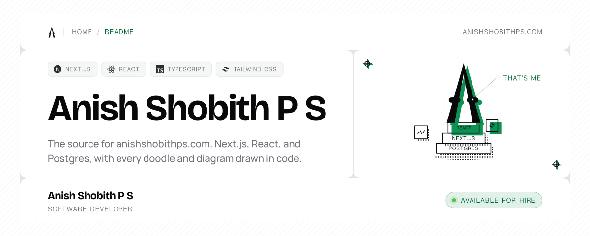
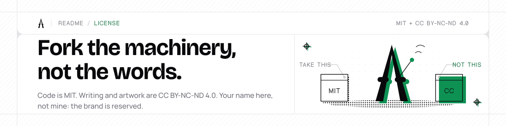

<p align="center">
  <picture>
    <source media="(prefers-color-scheme: dark)" srcset=".github/banner-dark.svg"/>
    
  </picture>
</p>

<p align="center">
  <a href="https://anishshobithps.com">Live site</a> /
  <a href="https://anishshobithps.com/blogs">Blog</a> /
  <a href="https://anishshobithps.com/feed.xml">RSS</a> /
  <a href="https://anishshobithps.com/branding">Branding</a> /
  <a href="https://anishshobithps.com/privacy-policy">Privacy</a>
</p>

Source code for [anishshobithps.com](https://anishshobithps.com): a portfolio, blog, and guestbook. Interfaces, bots, and questionable automation scripts, mostly so I don't have to repeat myself.

## What's in here

- A portfolio and a blog. Posts are MDX with printed covers, reading time, anonymous reactions, view counts, and threaded comments.
- A guestbook and blog comments behind Clerk sign-in, with likes, pinning, and soft delete.
- Projects and short links that live in Postgres and are managed from an owner-only admin, which also charts traffic, behavior, and engagement.
- First-party analytics: Umami for page counts, and PostHog for heatmaps, replays, and custom events, both sent through this domain. PostHog waits for consent where the law asks for it, through a self-hosted c15t banner.
- A resume rendered inline from the latest GitHub release.
- `/svg` cards for GitHub READMEs, `/og` cards for link previews, and an RSS feed.
- Artwork drawn in code rather than exported: the print scenes, mascot, doodles, and OG card.
- A command palette, a draggable quick menu, and optional UI sounds that stay off until a visitor turns them on.

The full route list is in [Architecture](docs/architecture.md#routes).

---

## Quick start

Node 24+ and pnpm 11 (`corepack enable` is enough).

```bash
pnpm install
pnpm --filter web exec varlock load
pnpm db:migrate
pnpm db:consent:migrate
pnpm dev
```

Create `apps/web/.env.local` first. [varlock](https://varlock.dev) checks it against `apps/web/.env.schema`, and six variables are required: `DATABASE_URL` (a [Neon](https://neon.tech) database), `IP_HASH_SALT`, and the [Clerk](https://clerk.com) keys, webhook secret, and owner ID. [Development](docs/development.md) has the rest.

---

## Documentation

| | |
| --- | --- |
| [Development](docs/development.md) | Setup, environment variables, commands, checks, conventions |
| [Architecture](docs/architecture.md) | Routes, request flow, layout, database, short links, admin |
| [Writing posts](docs/writing.md) | Frontmatter, revisions, links, citations, covers, publishing |
| [Design](docs/design.md) | The print art, the `/svg` cards, UI sounds |
| [Analytics and consent](docs/analytics.md) | Umami, PostHog through `/relay`, events, the c15t banner |
| [Deployment](docs/deployment.md) | Vercel, the first-deploy checklist, forking |

---

## License

<p align="center">
  <picture>
    <source media="(prefers-color-scheme: dark)" srcset=".github/license-dark.svg"/>
    
  </picture>
</p>

Code is [MIT](LICENSE-MIT), including the code blocks in this README, the docs, and blog posts. The prose and artwork, including artwork drawn in code, are [CC BY-NC-ND 4.0](LICENSE-CC-BY-NC-ND). The name, logo, mascot, likeness, and brand identity are not licensed for use as your own. [`LICENSE.md`](LICENSE.md) has the exact scope, and [Deployment](docs/deployment.md#forking) has the checklist for a fork.
